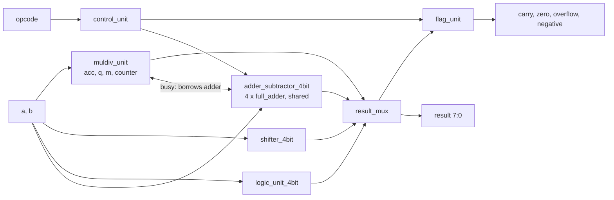

# 4-bit ALU with shift-based multiply and divide

A 4-bit Arithmetic Logic Unit written in Verilog with **10 operations**. Eight of them are single-cycle (combinational). **Multiply and divide are done by shifting** and by **re-using the ALU's own adder/subtractor**, instead of adding a separate multiplier or divider array.

- 4-bit operands `a`, `b`, **8-bit result** (holds a full 4×4 product)
- Flags: `carry`, `zero`, `overflow`, `negative`, `div_by_zero`; status: `busy`, `done`
- 9 design files + 1 self-checking testbench, ready to add to a Vivado project
- Exhaustively verified: every input combination of every operation, 0 errors

A full write-up (theory, worked examples, gate-level diagrams, synthesis numbers) is in [`ALU_4bit_Report.pdf`](ALU_4bit_Report.pdf).

## Operations

| Opcode | Operation | `result[7:0]`            | Cycles | Flags affected              |
|:------:|:---------:|--------------------------|:------:|-----------------------------|
| `0000` | ADD       | `{0000, a + b}`          | 1      | C, V, Z, N                  |
| `0001` | SUB       | `{0000, a − b}`          | 1      | C (1 = no borrow), V, Z, N  |
| `0010` | AND       | `{0000, a & b}`          | 1      | Z, N                        |
| `0011` | OR        | `{0000, a \| b}`         | 1      | Z, N                        |
| `0100` | XOR       | `{0000, a ^ b}`          | 1      | Z, N                        |
| `0101` | NOT       | `{0000, ~a}`             | 1      | Z, N                        |
| `0110` | SHL       | `{0000, a << 1}`         | 1      | C (bit shifted out), Z, N   |
| `0111` | SHR       | `{0000, a >> 1}`         | 1      | C (bit shifted out), Z, N   |
| `1000` | MUL       | `a × b` (8 bits)         | 1 + 4  | Z                           |
| `1001` | DIV       | `{remainder, quotient}`  | 1 + 4  | Z, `div_by_zero`            |
| `1010`–`1111` | unused | `0000_0000`         | –      | Z = 1                       |

## Ports of `alu_4bit`

| Port | Dir | Width | Description |
|------|-----|:-----:|-------------|
| `clk` | in | 1 | Clock (used only by MUL/DIV) |
| `rst` | in | 1 | Asynchronous reset, active high |
| `start` | in | 1 | Pulse for one clock to begin MUL/DIV |
| `a`, `b` | in | 4 each | Operands |
| `opcode` | in | 4 | Operation select (table above) |
| `result` | out | 8 | Answer |
| `carry`, `zero`, `overflow`, `negative` | out | 1 each | Status flags |
| `div_by_zero` | out | 1 | Last DIV had `b = 0` |
| `busy`, `done` | out | 1 each | MUL/DIV running / finished |

### Flags

| Flag | Meaning |
|------|---------|
| `carry` | ADD: carry out · SUB: 1 = no borrow (`a ≥ b`) · SHL/SHR: bit shifted out |
| `overflow` | Signed overflow on ADD/SUB only (`C3 ⊕ C4`) |
| `zero` | All 8 result bits are 0 |
| `negative` | `result[3]` for 4-bit operations; always 0 for MUL/DIV (unsigned) |

## How to use

**Single-cycle operations** (everything except MUL/DIV): set `a`, `b`, `opcode`. The result and flags appear straight away.

**MUL / DIV**: set `a`, `b`, `opcode`, pulse `start` for one clock edge, wait until `done = 1`, then read `result`.

```
clk    _|‾|_|‾|_|‾|_|‾|_|‾|_|‾|_
start  ___|‾‾‾|___________________
busy   _______|‾‾‾‾‾‾‾‾‾‾‾‾‾‾‾‾‾|__   (4 clocks)
done   _____________________|‾‾‾‾‾‾   (result held until next start)
```

Rules:

- Keep `opcode` set to MUL or DIV while reading, because the result multiplexer selects by opcode.
- `a` and `b` are latched at `start`; changing them while `busy` has no effect, and `start` is ignored while `busy`.
- While `busy = 1` the shared adder belongs to the multiply/divide unit, so **do not switch to ADD/SUB until `done = 1`**. Also, `result` and `zero` hold intermediate values until `done`.
- Divide by zero returns quotient `1111`, remainder = `a`, and sets `div_by_zero = 1`.

## How multiply and divide work

Both share the same three 4-bit registers (`acc`, `q`, `m`), the same 2-bit step counter, and the ALU's own adder/subtractor. Each takes 4 steps, one per clock.

**MUL — shift-and-add**

```
load: acc = 0, q = b (multiplier), m = a (multiplicand)
repeat 4 times:
    if q[0] == 1:  {C, acc} = acc + m
    else:          C = 0
    {C, acc, q} = {C, acc, q} >> 1
product = {acc, q}
```

**DIV — restoring shift-and-subtract**

```
load: acc = 0 (remainder), q = a (dividend), m = b (divisor)
repeat 4 times:
    {acc, q} = {acc, q} << 1
    if acc − m fits (no borrow):  acc = acc − m, q[0] = 1
    else:                         keep acc,      q[0] = 0
quotient = q, remainder = acc
```

Example, `13 × 11`:

| Clock  | What happens                              | `acc`  | `q`    |
|--------|-------------------------------------------|:------:|:------:|
| load   | `acc = 0`, `q = 1011`, `m = 1101`         | `0000` | `1011` |
| step 1 | `q[0]=1`: `0000 + 1101`, shift right      | `0110` | `1101` |
| step 2 | `q[0]=1`: `0110 + 1101`, shift right      | `1001` | `1110` |
| step 3 | `q[0]=0`: shift right                     | `0100` | `1111` |
| step 4 | `q[0]=1`: `0100 + 1101`, shift right      | `1000` | `1111` |

Product = `{acc, q}` = `1000_1111` = **143**.

## Architecture

All units work on `a` and `b` at the same time; `result_mux` picks the answer for the requested opcode. While MUL/DIV is running, two small muxes in `alu_4bit.v` hand the adder to `muldiv_unit`.



### Files

| File | Role |
|------|------|
| `alu_4bit.v` | Top level: instantiates and wires everything; contains the adder input muxes |
| `control_unit.v` | Decodes the opcode into `sub`, `arith`, `is_shl`, `is_shr`, `is_div`, `is_muldiv` |
| `adder_subtractor_4bit.v` | 4-bit ripple-carry adder/subtractor (`B` XOR `sub`, `sub` as carry-in) |
| `full_adder.v` | 1-bit full adder built from gates |
| `logic_unit_4bit.v` | AND, OR, XOR, NOT |
| `shifter_4bit.v` | Shift left/right by 1 (wiring only) and the bit shifted out |
| `muldiv_unit.v` | Sequential multiplier/divider: registers, counter, IDLE/RUN control (the only clocked file) |
| `result_mux.v` | Selects the 8-bit result by opcode |
| `flag_unit.v` | Computes carry, overflow, zero, negative |
| `alu_4bit_tb.v` | Self-checking testbench (simulation only) |

## Why shift-based

Synthesised with Yosys 0.33 and mapped to simple 2-input gates:

| Design | Logic gates | Flip-flops |
|--------|:-----------:|:----------:|
| 8-operation ALU (no MUL/DIV) | 125 | 0 |
| ALU + combinational array multiplier and divider | 289 | 0 |
| ALU + shift-based MUL/DIV (this design) | 193 | 18 |

At 4 bits the total area is about the same, because a flip-flop costs several gates. The array grows with n² while the shift-based unit grows with n, so the saving appears as the width increases. The price is time: 1 clock to load plus 4 to compute, instead of one long combinational delay.

## Simulation and verification

`alu_4bit_tb.v` runs four parts:

1. **Examples**: prints a readable table of each operation.
2. **Single-cycle operations**: all 14 non-MUL/DIV opcodes × 256 `(a, b)` pairs = 3,584 cases against a reference model (result, carry, overflow, zero, negative).
3. **MUL and DIV**: all 256 pairs each = 512 cases: product, quotient/remainder, divide-by-zero, exactly 5 clocks from `start` to `done`, and C/V/N = 0.
4. **Protocol**: operands latched at `start`, `start` ignored while busy, result held after `done`, reset in the middle of an operation.

A watchdog ends the run if the design ever hangs. Expected output ends with:

```
PASS: 3584 single-cycle + 512 MUL/DIV (with flag/status checks) + protocol checks, 0 errors
```

### Run with Vivado

1. **Create Project → RTL Project**, pick any part.
2. **Add Sources → Design sources**: add the nine design files (everything except `alu_4bit_tb.v`).
3. **Add Sources → Simulation sources**: add `alu_4bit_tb.v`.
4. Check that `alu_4bit` is the design top and `alu_4bit_tb` is the simulation top.
5. **Run Behavioral Simulation**, then click **Run All** (Vivado stops at 1000 ns by default; this test needs about 35 µs). Results appear in the Tcl Console.
